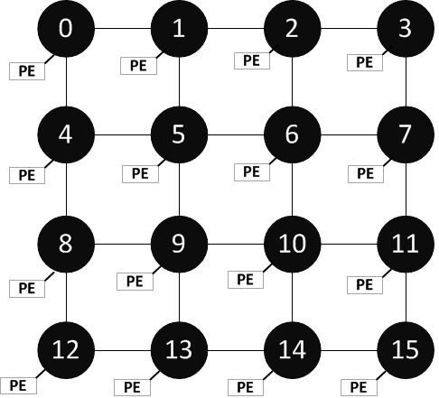

# VHDL NoC Router - 2D Mesh (Wormhole Switching)

A complete VHDL implementation of a **5-Port Network-on-Chip (NoC) Router** based on **Wormhole Switching**, **XY Routing**, and **Credit-Based Flow Control**.

This project demonstrates the operation of a small-scale **2D Mesh NoC** by implementing and connecting **Router 9** and **Router 10** from a larger **4×4 Mesh Network (16 Routers)**. The design includes FIFO buffers, routing units, arbiters, and a crossbar switch to emulate realistic packet transmission between routers.

---

## Overview

### Topology

* 2D Mesh Network

### Routing Algorithm

* Deterministic XY Routing

### Switching Technique

* Wormhole Switching

### Arbitration

* Round-Robin Arbitration (per output port)

### Flow Control

* Credit-Based Flow Control

### Implemented Routers

* Router ID 9
* Router ID 10

The two routers are connected through their East-West ports to demonstrate inter-router communication within a larger mesh architecture.

---

## Features

* 5-Port Router Architecture

  * Local
  * North
  * South
  * East
  * West

* Deterministic XY Routing Unit

* Wormhole Packet Switching

* Synchronous FIFO Buffers

* 5×5 Crossbar Switch

* Round-Robin Arbitration

* Credit-Based Flow Control

* Multi-Router Communication

* Comprehensive Testbenches

* Modular and Synthesizable VHDL Design

---

## Project Structure

```text
VHDL-NoC-Router/
├── README.md
├── .gitignore
├── compile.do
├── docs/
│   └── images/
│       └── 2d-mesh-2routers.png
├── arbiter_project/
├── CrossbarSwitch/
├── my_fifo/
├── router/
├── RoutingUnit/
└── two_routers/
    ├── two_routers.vhd                  
    └── TB_two_routers.vhd              
```

---

## Architecture

The router is composed of the following modules:

### FIFO Buffers

Input buffering for incoming flits.

### Routing Unit

Determines the appropriate output port using the XY routing algorithm.

### Arbiter

Resolves contention among multiple input ports requesting the same output port.

### Crossbar Switch

Provides dynamic connections between input and output ports.

### Flow Control Logic

Implements credit-based communication between neighboring routers.

---

## Mesh Network Example

The figure below illustrates the implemented portion of the mesh network.

<p align="center">
  
</p>

**Implemented Connection:**

```text
Router 9  <------>  Router 10
   East              West
```

This setup represents a small section of a larger 4×4 mesh network.

---

## Simulation

### Compile

```tcl
do compile.do
```

### Run Simulation

```tcl
vsim work.tb_two_routers
add wave -r sim:/tb_two_routers/*
run 1000 ns
```

---

## Verification

The provided testbench verifies:

* Header and Tail Flit Transmission
* XY Routing Decisions
* FIFO Read/Write Operations
* Crossbar Switching
* Arbitration Under Contention
* Credit-Based Flow Control
* Communication Between Router 9 and Router 10

---

## Technologies

* VHDL
* ModelSim
* FPGA-Oriented Digital Design
* Network-on-Chip (NoC) Architecture

---

## Project Information

Final Project for the **Digital Systems Design Laboratory** course.
 
Implementation Language: VHDL

Simulation Environment: ModelSim / QuestaSim
